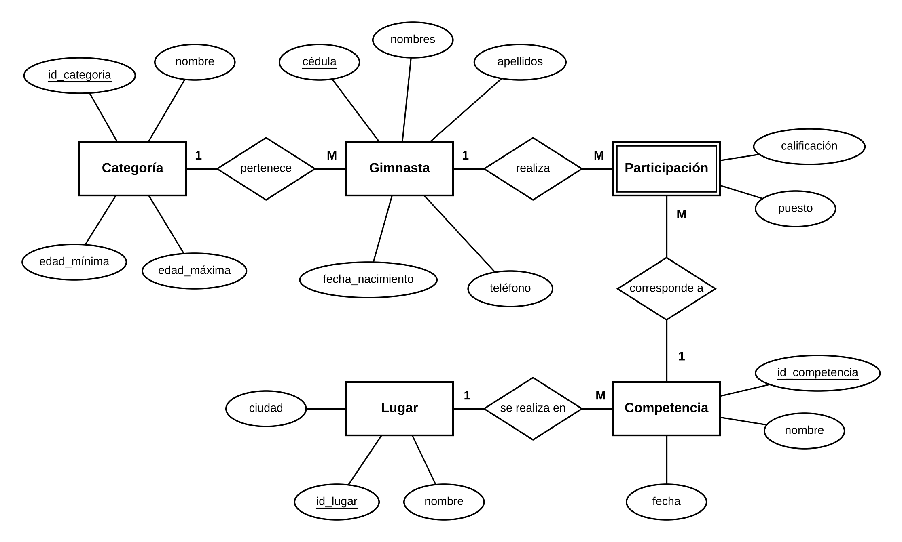
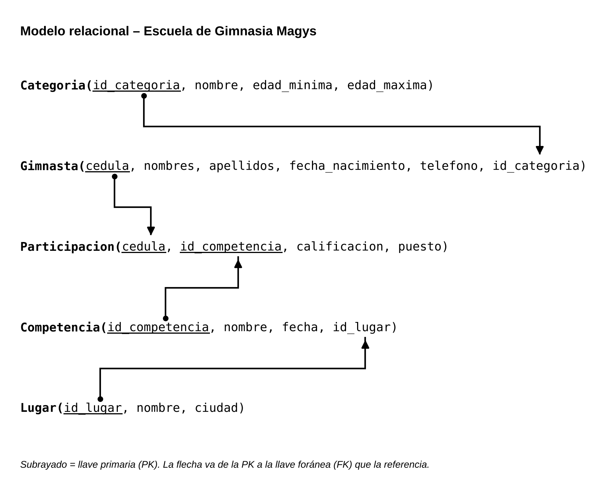

# INFORME DE FIN DE UNIDAD

## Datos Generales

| **Asignatura**                            | Base de datos                                                                                                                                              |
|-------------------------------------------|------------------------------------------------------------------------------------------------------------------------------------------------------------|
| **Ciclo**                                 | 3 A                                                                                                                                                        |
| **Unidad**                                | 1                                                                                                                                                          |
| **Resultado de aprendizaje de la unidad** | Modela bases de datos de problemas reales, bajo los principios de solidaridad, transparencia, responsabilidad y honestidad.                                |
| **Nombre del Docente**                    | Edwin René Guamán Quinche                                                                                                                                  |
| **Fecha**                                 | 11/11/2026                                                                                                                                                 |
| **Enlace de Git**                         | [BASE-DE-DATOS-PORTAFOLIO/index.md at main · seleeanis/BASE-DE-DATOS-PORTAFOLIO](https://github.com/seleeanis/BASE-DE-DATOS-PORTAFOLIO/blob/main/index.md) |
| **Nombres y apellidos del estudiante**    | Selena Castillo                                                                                                                                            |

## 1. TITULO

*"Implementación de un sistema web para la Gestión de competencias de gimnasia rítmica de la escuela Magys de Catamayo."*

## 2. CONTEXTO DEL PROBLEMA

La Escuela de Gimnasia Magys, del cantón Catamayo (provincia de Loja), forma deportistas de gimnasia rítmica y participa u organiza competencias a lo largo del año. Cada gimnasta debe registrarse con sus datos personales, ubicarse en la categoría que le corresponde según su edad y mantener el historial de sus resultados en cada competencia.

- **Situación o entorno:** El problema se presenta en la gestión diaria de la escuela: la inscripción de gimnastas, la asignación de la categoría por rango de edad (por ejemplo: Pre-infantil, Infantil, Junior y Senior) y el registro de las competencias con su nombre, fecha y lugar, junto con la calificación (de 0 a 10) y el puesto que obtiene cada gimnasta.

- **Dificultades sin una base de datos:** la información queda dispersa en registros manuales o archivos sueltos, lo que provoca datos duplicados, errores al asignar la categoría, dificultad para consultar el historial de resultados y pérdida de tiempo al preparar listados o clasificaciones por competencia.

- **A quiénes afecta:** A la dirección y a los entrenadores de la escuela, que necesitan información confiable para organizar su participación en competencias, y a las gimnastas y sus representantes, que requieren conocer sus resultados e historial deportivo.

- **Datos a gestionar:** Los datos de las gimnastas (cédula, nombres, apellidos, fecha de nacimiento y teléfono de contacto), las categorías con su rango de edad, las competencias (nombre, fecha y lugar) y la participación de cada gimnasta (calificación y puesto). Gestionarlos correctamente garantiza que cada gimnasta pertenezca a una sola categoría, que la calificación esté entre 0 y 10 y que no se repita su participación en una misma competencia.

## 3. OBJETIVOS

### 3.1. Objetivo General

Diseñar e implementar una base de datos relacional, mediante los modelos Entidad-Relación y Relacional y el lenguaje SQL, para registrar y consultar la información de las gimnastas, sus categorías y su participación en las competencias de la Escuela de Gimnasia Magys de Catamayo.

### 3.2. Objetivos Específicos

1.  Elaborar el diagrama Entidad-Relación y el modelo relacional de la escuela, identificando cinco entidades (Categoría, Gimnasta, Competencia, Lugar y Participación) con sus atributos, llaves primarias, llaves foráneas y cardinalidades.

2.  Construir el esquema físico en SQL (creación de tablas con sus restricciones e inserción de datos de ejemplo) y formular cinco consultas en álgebra relacional traducidas a SQL para obtener información de las competencias y de los resultados de las gimnastas.

## 4. MODELOS CONCEPTUALES DE BASES DE DATOS

### 4.1. Modelo Entidad-Relación (E-R)

A partir del enunciado se identificaron cinco entidades. El diagrama de la Figura 1 se elaboró con la notación de Chen [1]: las entidades se representan con rectángulos (la entidad asociativa Participación, con borde doble), los atributos con elipses, las relaciones con rombos y las llaves primarias van subrayadas. Todos los atributos son simples; no existen atributos compuestos, derivados ni multivaluados.

- **Entidades:** Categoría, Gimnasta, Competencia, Lugar y Participación (entidad asociativa que resuelve la relación muchos a muchos entre Gimnasta y Competencia).

- **Atributos:** Categoría (id_categoria, nombre, edad_mínima, edad_máxima); Gimnasta (cédula, nombres, apellidos, fecha_nacimiento, teléfono); Competencia (id_competencia, nombre, fecha); Lugar (id_lugar, nombre, ciudad); Participación (calificación, puesto).

- **Relaciones:** pertenece (Categoría–Gimnasta), realiza (Gimnasta–Participación), corresponde a (Participación–Competencia) y se realiza en (Lugar–Competencia).

- **Cardinalidades:** Categoría–Gimnasta 1:N (cada gimnasta pertenece a una sola categoría); Gimnasta–Participación 1:N; Competencia–Participación 1:N; Lugar–Competencia 1:N. En conjunto, Gimnasta–Competencia es M:N, ya que una gimnasta participa en muchas competencias y una competencia reúne a muchas gimnastas.

- **Llaves primarias:** id_categoria, cédula, id_competencia e id_lugar; la entidad Participación se identifica por la combinación (cédula, id_competencia).

<p align="center">
  
</p>


<p align="center"><em>Figura 1. Diagrama Entidad-Relación del sistema de gestión de competencias de la Escuela de Gimnasia Magys.</em></p>

### 4.2. Modelo Relacional

El modelo relacional se derivó del diagrama E-R aplicando las reglas de transformación [2], [3]: cada entidad pasó a ser una tabla con su llave primaria; las relaciones 1:N se resolvieron colocando la llave foránea en la tabla del lado «muchos» (Gimnasta.id_categoria y Competencia.id_lugar); y la relación M:N entre Gimnasta y Competencia se resolvió con la tabla Participacion, cuya llave primaria compuesta (cedula, id_competencia) está formada por dos llaves foráneas. Los nombres de tablas y atributos se escriben sin tildes para evitar problemas de codificación en el gestor.

Modelo relacional (la llave primaria está subrayada y la flecha va de la llave primaria a la llave foránea que la referencia):


<p align="center">
  
</p>


<p align="center"><em>Figura 2. Modelo relacional del sistema de gestión de competencias de la Escuela de Gimnasia Magys.</em></p>

A continuación se detalla cada tabla con el tipo de dato sugerido de sus atributos, su llave primaria (PK) y sus llaves foráneas (FK):

**Tabla Categoria**

| **Atributo** | **Tipo de dato** | **Clave** | **Descripción**                          |
|--------------|------------------|-----------|------------------------------------------|
| id_categoria | INT              | PK        | Identificador de la categoría            |
| nombre       | VARCHAR(30)      | —         | Nombre (Pre-infantil, Infantil, Junior…) |
| edad_minima  | INT              | —         | Edad mínima del rango                    |
| edad_maxima  | INT              | —         | Edad máxima del rango                    |

**Tabla Gimnasta**

| **Atributo**     | **Tipo de dato** | **Clave**                    | **Descripción**                    |
|------------------|------------------|------------------------------|------------------------------------|
| cedula           | VARCHAR(10)      | PK                           | Cédula de identidad                |
| nombres          | VARCHAR(50)      | —                            | Nombres de la gimnasta             |
| apellidos        | VARCHAR(50)      | —                            | Apellidos de la gimnasta           |
| fecha_nacimiento | DATE             | —                            | Fecha de nacimiento                |
| telefono         | VARCHAR(10)      | —                            | Teléfono de contacto               |
| id_categoria     | INT              | FK → Categoria(id_categoria) | Categoría única a la que pertenece |

**Tabla Lugar**

| **Atributo** | **Tipo de dato** | **Clave** | **Descripción**               |
|--------------|------------------|-----------|-------------------------------|
| id_lugar     | INT              | PK        | Identificador del lugar       |
| nombre       | VARCHAR(60)      | —         | Nombre del escenario          |
| ciudad       | VARCHAR(40)      | —         | Ciudad (por defecto Catamayo) |

**Tabla Competencia**

| **Atributo**   | **Tipo de dato** | **Clave**            | **Descripción**                 |
|----------------|------------------|----------------------|---------------------------------|
| id_competencia | INT              | PK                   | Identificador de la competencia |
| nombre         | VARCHAR(80)      | —                    | Nombre de la competencia        |
| fecha          | DATE             | —                    | Fecha de realización            |
| id_lugar       | INT              | FK → Lugar(id_lugar) | Lugar donde se realiza          |

**Tabla Participacion**

| **Atributo**   | **Tipo de dato** | **Clave**                            | **Descripción**                 |
|----------------|------------------|--------------------------------------|---------------------------------|
| cedula         | VARCHAR(10)      | PK, FK → Gimnasta(cedula)            | Gimnasta que participa          |
| id_competencia | INT              | PK, FK → Competencia(id_competencia) | Competencia en la que participa |
| calificacion   | DECIMAL(4,2)     | —                                    | Calificación obtenida (0 a 10)  |
| puesto         | INT              | —                                    | Puesto alcanzado                |

## 5. CÓDIGO SQL

### 5.1. Creación de Tablas (DDL)

El siguiente script crea las cinco tablas del sistema (sintaxis de MySQL [3]). Se usan las restricciones PRIMARY KEY, FOREIGN KEY, NOT NULL, UNIQUE, DEFAULT y CHECK para proteger la integridad de los datos: la calificación debe estar entre 0 y 10, el puesto debe ser positivo y la edad máxima de una categoría no puede ser menor que la mínima. Las tablas se crean en orden: primero las que no dependen de otras (Categoria y Lugar) y luego las que las referencian.

```sql
CREATE TABLE Categoria (
    id_categoria INT NOT NULL AUTO_INCREMENT,
    nombre VARCHAR(30) NOT NULL UNIQUE,
    edad_minima INT NOT NULL,
    edad_maxima INT NOT NULL,
    PRIMARY KEY (id_categoria),
    CHECK (edad_maxima >= edad_minima)
);

CREATE TABLE Gimnasta (
    cedula VARCHAR(10) NOT NULL,
    nombres VARCHAR(50) NOT NULL,
    apellidos VARCHAR(50) NOT NULL,
    fecha_nacimiento DATE NOT NULL,
    telefono VARCHAR(10) NOT NULL,
    id_categoria INT NOT NULL,
    PRIMARY KEY (cedula),
    FOREIGN KEY (id_categoria) REFERENCES Categoria(id_categoria)
);

CREATE TABLE Lugar (
    id_lugar INT NOT NULL AUTO_INCREMENT,
    nombre VARCHAR(60) NOT NULL,
    ciudad VARCHAR(40) NOT NULL DEFAULT 'Catamayo',
    PRIMARY KEY (id_lugar)
);

CREATE TABLE Competencia (
    id_competencia INT NOT NULL AUTO_INCREMENT,
    nombre VARCHAR(80) NOT NULL,
    fecha DATE NOT NULL,
    id_lugar INT NOT NULL,
    PRIMARY KEY (id_competencia),
    FOREIGN KEY (id_lugar) REFERENCES Lugar(id_lugar)
);

CREATE TABLE Participacion (
    cedula VARCHAR(10) NOT NULL,
    id_competencia INT NOT NULL,
    calificacion DECIMAL(4,2) NOT NULL,
    puesto INT NOT NULL,
    PRIMARY KEY (cedula, id_competencia),
    FOREIGN KEY (cedula) REFERENCES Gimnasta(cedula),
    FOREIGN KEY (id_competencia) REFERENCES Competencia(id_competencia),
    CHECK (calificacion BETWEEN 0 AND 10),
    CHECK (puesto >= 1)
);
```

### 5.2. Inserción de Datos (DML)

Se insertan datos de ejemplo ficticios en las cinco tablas (5 categorías, 11 gimnastas, 5 lugares, 5 competencias y 23 participaciones). Las llaves foráneas corresponden a registros ya insertados, por lo que las sentencias deben ejecutarse en este orden. Se incluye una gimnasta sin participaciones y gimnastas de todas las categorías para que las consultas posteriores produzcan resultados variados.

```sql
-- Categoria
INSERT INTO Categoria (id_categoria, nombre, edad_minima, edad_maxima)
VALUES
    (1, 'Pre-infantil', 4, 6),
    (2, 'Infantil', 7, 9),
    (3, 'Pre-juvenil', 10, 12),
    (4, 'Junior', 13, 15),
    (5, 'Senior', 16, 99);

-- Gimnasta (datos ficticios)
INSERT INTO Gimnasta (cedula, nombres, apellidos, fecha_nacimiento,
    telefono, id_categoria)
VALUES
    ('1100000001', 'Camila Andrea', 'Torres Jimenez', '2021-03-15', '0990000001', 1),
    ('1100000002', 'Valentina Sofia', 'Ordonez Ramirez', '2020-07-22', '0990000002', 1),
    ('1100000003', 'Emily Domenica', 'Cueva Gaona', '2018-05-10', '0990000003', 2),
    ('1100000004', 'Mariana Belen', 'Armijos Pardo', '2017-11-30', '0990000004', 2),
    ('1100000005', 'Domenica Alejandra', 'Salinas Lapo', '2015-02-18', '0990000005', 3),
    ('1100000006', 'Antonella Nicole', 'Macas Jaramillo', '2014-09-03', '0990000006', 3),
    ('1100000007', 'Ariana Paola', 'Granda Poma', '2012-01-25', '0990000007', 4),
    ('1100000008', 'Luciana Estefania', 'Reyes Cabrera', '2011-06-12', '0990000008', 4),
    ('1100000009', 'Karla Julieth', 'Vivanco Ochoa', '2009-08-19', '0990000009', 5),
    ('1100000010', 'Paula Gabriela', 'Sarango Luzuriaga', '2008-12-04', '0990000010', 5),
    ('1100000011', 'Salome Anahi', 'Pineda Correa', '2019-04-08', '0990000011', 2);

-- Lugar
INSERT INTO Lugar (id_lugar, nombre, ciudad)
VALUES
    (1, 'Coliseo Municipal de Catamayo', 'Catamayo'),
    (2, 'Coliseo Ciudad de Loja', 'Loja'),
    (3, 'Gimnasio Escuela Magys', 'Catamayo'),
    (4, 'Coliseo de Cariamanga', 'Cariamanga'),
    (5, 'Coliseo Municipal de Macara', 'Macara');

-- Competencia
INSERT INTO Competencia (id_competencia, nombre, fecha, id_lugar)
VALUES
    (1, 'Torneo Interno Magys 2026', '2026-03-14', 3),
    (2, 'Copa Catamayo de Gimnasia', '2026-05-23', 1),
    (3, 'Campeonato Provincial de Loja', '2026-07-18', 2),
    (4, 'Festival Gimnastico del Sur', '2026-09-12', 4),
    (5, 'Torneo Intercantonal de Macara', '2026-10-24', 5);

-- Participacion
INSERT INTO Participacion (cedula, id_competencia, calificacion, puesto)
VALUES
    ('1100000003', 1, 8.50, 4), ('1100000005', 1, 9.10, 2),
    ('1100000007', 1, 9.40, 1), ('1100000001', 1, 8.80, 3),
    ('1100000002', 2, 8.70, 5), ('1100000004', 2, 9.20, 3),
    ('1100000006', 2, 9.00, 4), ('1100000008', 2, 9.50, 1),
    ('1100000009', 2, 9.30, 2),
    ('1100000005', 3, 9.35, 3), ('1100000006', 3, 8.95, 5),
    ('1100000007', 3, 9.60, 1), ('1100000008', 3, 9.45, 2),
    ('1100000010', 3, 9.25, 4),
    ('1100000003', 4, 9.05, 3), ('1100000004', 4, 8.60, 4),
    ('1100000009', 4, 9.55, 1), ('1100000010', 4, 9.40, 2),
    ('1100000001', 5, 8.90, 5), ('1100000002', 5, 9.15, 4),
    ('1100000005', 5, 9.30, 3), ('1100000007', 5, 9.50, 1),
    ('1100000009', 5, 9.45, 2);
```

## 6. CONSULTAS EN ÁLGEBRA RELACIONAL Y SQL

Se presentan cinco consultas formuladas primero en álgebra relacional [4] y luego traducidas a SQL. Cubren los operadores selección (σ), proyección (π), diferencia (−), reunión natural (⋈) y agrupamiento con funciones de agregación (γ), con complejidad creciente: desde una sola tabla hasta la reunión de cuatro tablas. Los resultados indicados corresponden a los datos de ejemplo de la sección 5.2.

### Consulta 1 — Selección (σ) con condición compuesta

Descripción: Obtener las participaciones que alcanzaron el 1.er o el 2.º puesto con una calificación de al menos 9.5 sobre 10.

**Álgebra Relacional:**

```text
σ puesto ≤ 2 ∧ calificacion ≥ 9.5 (Participacion)
```

**SQL:**

```sql
SELECT *
FROM Participacion
WHERE puesto <= 2
    AND calificacion >= 9.5;
```

**Resultado esperado:** Se obtienen 4 participaciones, todas con el 1.er puesto: la de la cédula 1100000008 en la Copa Catamayo de Gimnasia (9.50), la de 1100000007 en el Campeonato Provincial de Loja (9.60) y en el Torneo Intercantonal de Macara (9.50), y la de 1100000009 en el Festival Gimnastico del Sur (9.55). Se muestran las columnas cedula, id_competencia, calificacion y puesto.

### Consulta 2 — Proyección (π) y Diferencia (−)

Descripción: Listar los nombres y apellidos de las gimnastas que aún no han participado en ninguna competencia. Se restan, del conjunto de cédulas de Gimnasta, las cédulas que aparecen en Participacion.

**Álgebra Relacional:**

```text
π nombres, apellidos (Gimnasta ⋈ (π cedula (Gimnasta) − π cedula (Participacion)))
```

**SQL:**

```sql
SELECT g.nombres, g.apellidos
FROM Gimnasta g
WHERE NOT EXISTS (SELECT 1
    FROM Participacion p
    WHERE p.cedula = g.cedula);
```

**Resultado esperado:** Se obtiene un único registro: Salome Anahi Pineda Correa, la única gimnasta registrada que todavía no tiene participaciones.

### Consulta 3 — Selección con Proyección sobre una reunión (σ + π + ⋈)

Descripción: mostrar los nombres, apellidos y fecha de nacimiento de las gimnastas que pertenecen a la categoría Junior, combinando Gimnasta con Categoria.

**Álgebra Relacional:**

```text
π nombres, apellidos, fecha_nacimiento (σ Categoria.nombre = 'Junior'
  (Gimnasta ⋈ Gimnasta.id_categoria = Categoria.id_categoria Categoria))
```

**SQL:**

```sql
SELECT g.nombres, g.apellidos, g.fecha_nacimiento
FROM Gimnasta g
    JOIN Categoria c ON g.id_categoria = c.id_categoria
WHERE c.nombre = 'Junior';
```

**Resultado esperado:** Se obtienen 2 registros con las gimnastas de la categoría Junior: Ariana Paola Granda Poma (nacida el 2012-01-25) y Luciana Estefania Reyes Cabrera (nacida el 2011-06-12).

### Consulta 4 — Reunión natural de cuatro tablas (⋈)

Descripción: Obtener, para cada competencia, la gimnasta que alcanzó el primer puesto, junto con el lugar donde se realizó y su calificación.

**Álgebra Relacional:**

```text
π nombres, apellidos, Competencia.nombre, Lugar.nombre, calificacion
  (σ puesto = 1 (Gimnasta ⋈ Participacion ⋈ Competencia ⋈ Lugar))
```

**SQL:**

```sql
SELECT g.nombres, g.apellidos, co.nombre AS competencia,
    l.nombre AS lugar, p.calificacion
FROM Gimnasta g
    JOIN Participacion p ON g.cedula = p.cedula
    JOIN Competencia co ON p.id_competencia = co.id_competencia
    JOIN Lugar l ON co.id_lugar = l.id_lugar
WHERE p.puesto = 1
ORDER BY co.fecha;
```

**Resultado esperado:** Se obtienen 5 filas, una por competencia, con la ganadora, el lugar y su calificación: Ariana Paola Granda Poma ganó tres competencias (Torneo Interno Magys 2026 con 9.40, Campeonato Provincial de Loja con 9.60 y Torneo Intercantonal de Macara con 9.50), Luciana Estefania Reyes Cabrera ganó la Copa Catamayo de Gimnasia (9.50) y Karla Julieth Vivanco Ochoa el Festival Gimnastico del Sur (9.55).

### Consulta 5 — Agrupamiento y funciones de agregación (γ)

Descripción: Contar cuántas gimnastas hay registradas en cada categoría.

**Álgebra Relacional:**

```text
γ Categoria.nombre; COUNT(*) → total_gimnastas (Categoria ⋈ Gimnasta)
```

**SQL:**

```sql
SELECT c.nombre AS categoria,
    COUNT(*) AS total_gimnastas
FROM Categoria c
    JOIN Gimnasta g ON c.id_categoria = g.id_categoria
GROUP BY c.nombre
ORDER BY total_gimnastas DESC, c.nombre;
```

**Resultado esperado:** Se obtienen 5 filas, una por categoría: Infantil con 3 gimnastas y Junior, Pre-infantil, Pre-juvenil y Senior con 2 gimnastas cada una (11 gimnastas en total).

## 7. CONCLUSIONES

- **Conclusión 1:** El modelado conceptual permitió convertir el enunciado de la escuela en cinco entidades con sus atributos, relaciones y cardinalidades. La parte más delicada fue la relación muchos a muchos entre Gimnasta y Competencia: la calificación y el puesto no pertenecen a la gimnasta ni a la competencia, sino a cada participación, por lo que se resolvió con la entidad asociativa Participación y su llave primaria compuesta. Del mismo modo, tratar Categoría y Lugar como entidades propias, y no como simples atributos, evita repetir datos y facilita su mantenimiento. Una vez identificadas las llaves, el paso del diagrama E-R al modelo relacional [2], [3] resultó prácticamente mecánico.

- **Conclusión 2:** Escribir el código SQL permitió comprobar que el diseño se traduce en reglas concretas dentro de la base de datos. Las restricciones PRIMARY KEY, FOREIGN KEY, NOT NULL, UNIQUE, DEFAULT y CHECK garantizan, por ejemplo, que cada gimnasta pertenezca a una sola categoría, que la calificación esté entre 0 y 10 y que una gimnasta no se registre dos veces en la misma competencia. Al insertar los datos de ejemplo se evidenció además la importancia del orden: primero las tablas de las que otras dependen (Categoria y Lugar) y después las que las referencian.

- **Conclusión 3:** Formular cada consulta primero en álgebra relacional [4] ayuda a decidir qué operación se necesita (selección, proyección, diferencia, reunión o agrupamiento) antes de escribir la sentencia, y la traducción a SQL resulta casi directa: σ corresponde a WHERE, π a SELECT, ⋈ a JOIN, − a NOT EXISTS y γ a GROUP BY con funciones de agregación. Las consultas más útiles para la escuela fueron la reunión de cuatro tablas, que muestra a la ganadora de cada competencia con su lugar, y el agrupamiento por categoría, que resume el rendimiento promedio de cada una.

## 8. BIBLIOGRAFÍA

[1] P. P. Chen, "The entity-relationship model—toward a unified view of data," ACM Trans. Database Syst., vol. 1, no. 1, pp. 9–36, Mar. 1976, doi: 10.1145/320434.320440.

[2] E. F. Codd, "A relational model of data for large shared data banks," Commun. ACM, vol. 13, no. 6, pp. 377–387, Jun. 1970, doi: 10.1145/362384.362685.

[3] R. Elmasri and S. B. Navathe, Fundamentals of Database Systems, 7th ed. Hoboken, NJ, USA: Pearson, 2016.

[4] A. Silberschatz, H. F. Korth, and S. Sudarshan, Database System Concepts, 7th ed. New York, NY, USA: McGraw-Hill Education, 2019.

